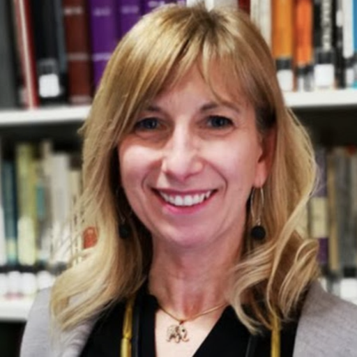
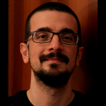
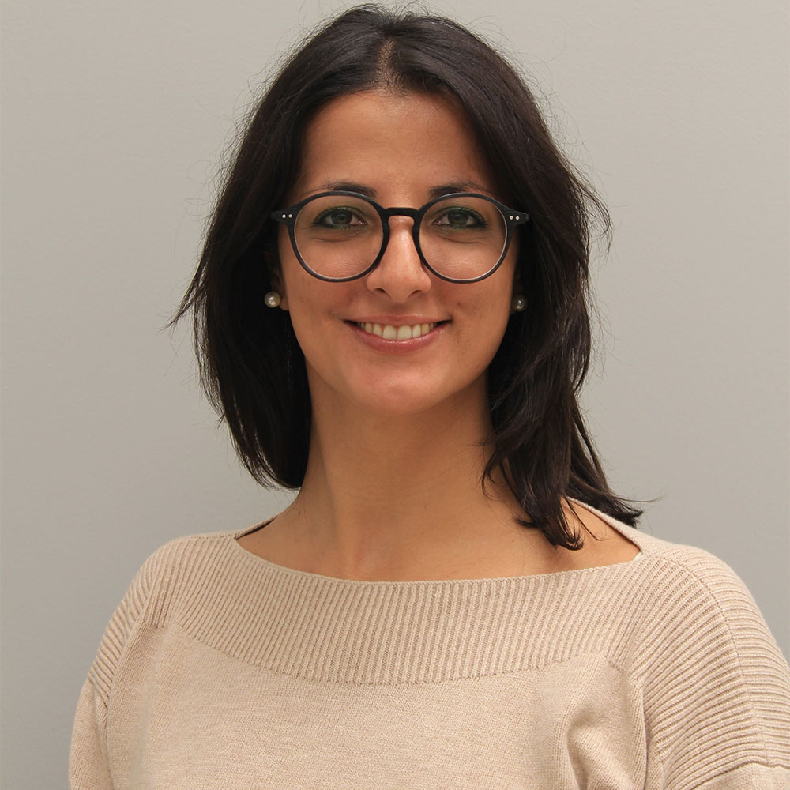

::: {.prose}
GEMS is developed by researchers from the University of Padua and IRCCS San Camillo Hospital in Venice, who are members of the [NICLA group](https://nicla-group.github.io/) (Neuropsychology: Innovative concepts for Clinical Assessment and rehabilitation).
:::

::: {.people}
::: {.person}
{fig-alt="Sara Mondini"}

### Sara Mondini

[University of Padua]{.role}
:::

::: {.person}
{fig-alt="Giorgio Arcara"}

### [Giorgio Arcara](https://giorgioarcara.github.io)

[University of Padua]{.role}
:::

::: {.person}
{fig-alt="Sonia Montemurro"}

### Sonia Montemurro

[University of Padua]{.role}
:::
:::

::: {.prose}
Photos courtesy of the [NICLA group](https://nicla-group.github.io/people.html).
The GEMS tools were developed with many colleagues; see the [publications](project.qmd#publications) for the full author lists.
:::
